# DeployForge

**A developer portal that takes a Git commit through CI, security scanning, image publication and a verified Kubernetes rollout.**

DeployForge is a platform engineering portfolio project. A developer chooses a registered repository, selects a commit and clicks **Create Tag & Deploy**. The backend follows the actual GitHub Actions run, validates its published image, promotes the version through GitOps and checks whether Kubernetes reached the intended healthy state. The same dashboard supports image deployment, rollback, security evidence, monitoring and incident investigation.

**Stack:** React · Express · Go · GitHub Actions · Docker / GHCR · Trivy · Helm · ArgoCD · Kubernetes · Prometheus · Grafana · optional OpenAI

[UI gallery](#dashboard-screenshots) · [Architecture](#how-a-release-works) · [Workflow walkthrough](#workflow-walkthrough) · [Test evidence](docs/testing/README.md) · [Local setup](#run-locally) · [Limitations](#scope-and-limitations)

## Reviewer guide

Start with **Overview**, then **Create Release** and **Deployments** to understand the delivery path. **Security** exposes the CI scan evidence; **Monitoring** and **AI Troubleshooting** show how the running workload is investigated. Screenshots of every page and the rollback view appear directly below—no running cluster or external site is needed to view them.

| Capability | What is implemented |
| --- | --- |
| Self-service release | Approved repository, branch/full SHA lookup, version tag, exact workflow tracking and automatic GitOps promotion after verification |
| Deployment and rollback | Published SHA image verification, current/target confirmation, retained revision selection and health checks |
| Supply-chain checks | Blocking HIGH/CRITICAL Trivy scans for AMD64 and ARM64, run-attempt validation and image/source provenance |
| Operational visibility | Readiness, replicas, ArgoCD state, probe trends, scrape health and alerts grouped by workload |
| Incident investigation | Bounded real pod logs/events, evidence citations and read-only diagnosis; free local rules or optional OpenAI |
| Recovery and authorization | Durable release journal, idempotent requests, operation locks and terminal-approved browser sessions |

## The problem it solves

A green build does not prove a successful deployment. Source control, CI, registry publication, desired configuration and the running cluster can disagree. DeployForge connects those systems and their evidence, showing where delivery stopped instead of presenting an accepted request as a healthy release.

## How a release works

1. A developer pushes source code to the registered GitHub repository.
2. In **Create Release**, choose a branch or full commit SHA and enter a new version tag.
3. **Create Tag & Deploy** creates the tag. GitHub Actions runs Go tests and vet, builds native AMD64/ARM64 images and scans each image with Trivy.
4. HIGH/CRITICAL findings—including unfixed vulnerabilities—block publication. Successful tag workflows publish the scanned images, multi-platform index and release evidence to GHCR/Actions.
5. DeployForge validates the exact workflow run and attempt, source commit, tag, image digest and platform evidence. It then invokes the existing GitOps promotion engine automatically.
6. The engine changes the Helm image version, commits that desired state and pushes normally to `main`. ArgoCD reconciles it into Kubernetes.
7. Success requires the intended image, ready replicas and ArgoCD synchronization/health at the promoted Git commit. A timeout or partial result is not success.

```mermaid
flowchart LR
    Source[Developer source commit] --> UI[DeployForge: create tag]
    UI --> CI[Actions: test, build, scan]
    CI --> GHCR[GHCR: scanned images]
    GHCR --> Verify[DeployForge: verify evidence]
    Verify --> Git[Git: promote Helm image]
    Git --> Argo[ArgoCD: reconcile]
    Argo --> K8s[Kubernetes: rollout]
    K8s --> Health[DeployForge: verify health]
```

**CI builds and publishes; DeployForge promotes; ArgoCD applies.** CI does not write Helm values or deploy independently. Normal `main` pushes and pull requests run the configured source checks; registry publication is restricted to release-tag pushes. Application/workflow path filters avoid unnecessary branch builds for unrelated edits.

## Dashboard screenshots

Captured **6 November 2026, Asia/Kolkata**, from the existing local dashboard. These are point-in-time views, not continuous availability guarantees. A temporary authorized browser collected Kubernetes evidence and ran **local rule-based analysis**; it was disconnected afterward. No release, deployment, rollback or external model request was submitted. [Capture receipt](docs/images/capture-receipt.json).

### Overview — current workload and recent detections

Read workload readiness, current image, GitOps state and recent failures without switching between tools. Related signals are grouped by workload, with links into investigation.


### Create Release — one request and traceable release history

Select an approved repository and source, enter a version and follow tag creation → CI/security → publication → promotion → rollout. Source, workflow, image and GitOps evidence links remain with the release history.


### Deployments — promote an already published image

Choose an image, verify its availability and review the current and target images before confirming. Progress and retained Kubernetes revision history remain on the same page.


### Rollback — restore an eligible retained revision

Rollback produces a new GitOps commit for the selected previous image and follows the same rollout checks. This screenshot only opens the rollback view; it does not perform a rollback.

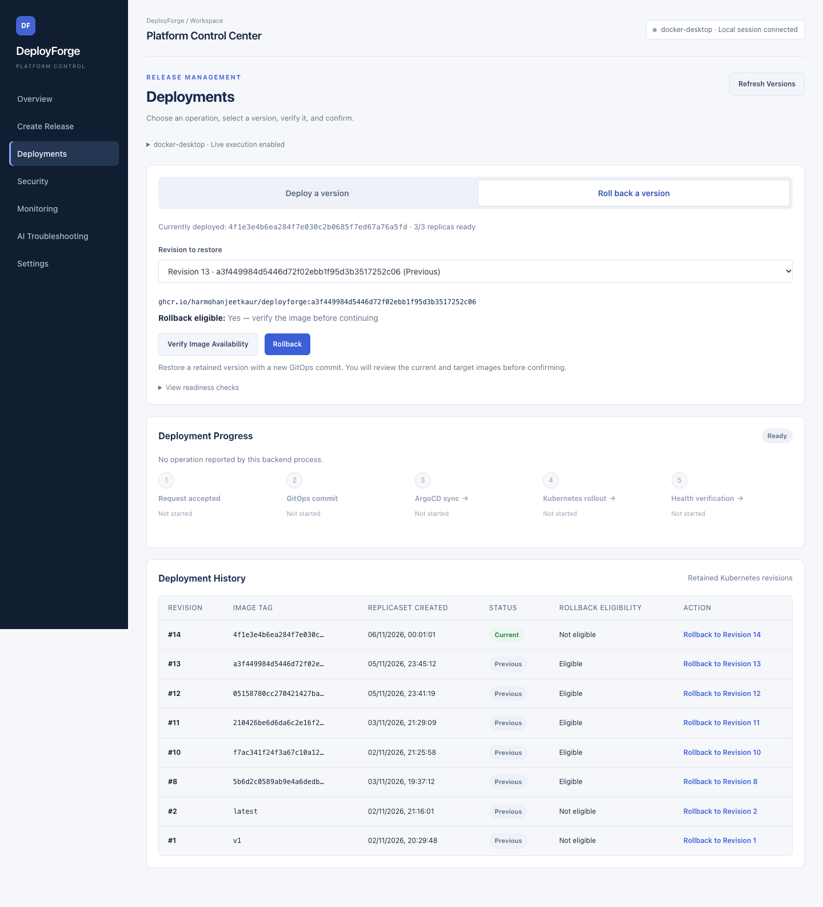

### Security — exact CI scan evidence, never assumed clean

The page validates Trivy reports from the selected release’s exact workflow attempt and shows architecture-specific findings, fixes and provenance. **The current capture shows unavailable reports because the running backend could not retrieve GitHub evidence. It is not a passed scan.** The implementation and its error handling are covered by automated tests; restoring backend GitHub access is required to view live reports again.


### Monitoring — signals first, expandable details

See readiness, available replicas, probe availability/latency, prioritized scrape targets and alert activity. Related alerts are grouped, while raw identifiers and full details remain expandable. Missing metrics stay unavailable rather than becoming zero.


### AI Troubleshooting — collect and inspect real evidence

Select a workload and collect pod state, events, bounded current/previous logs, ArgoCD metadata and monitoring signals. Review the snapshot before analysis. Controlled failure workloads are isolated from the healthy application; their origins remain in metadata.

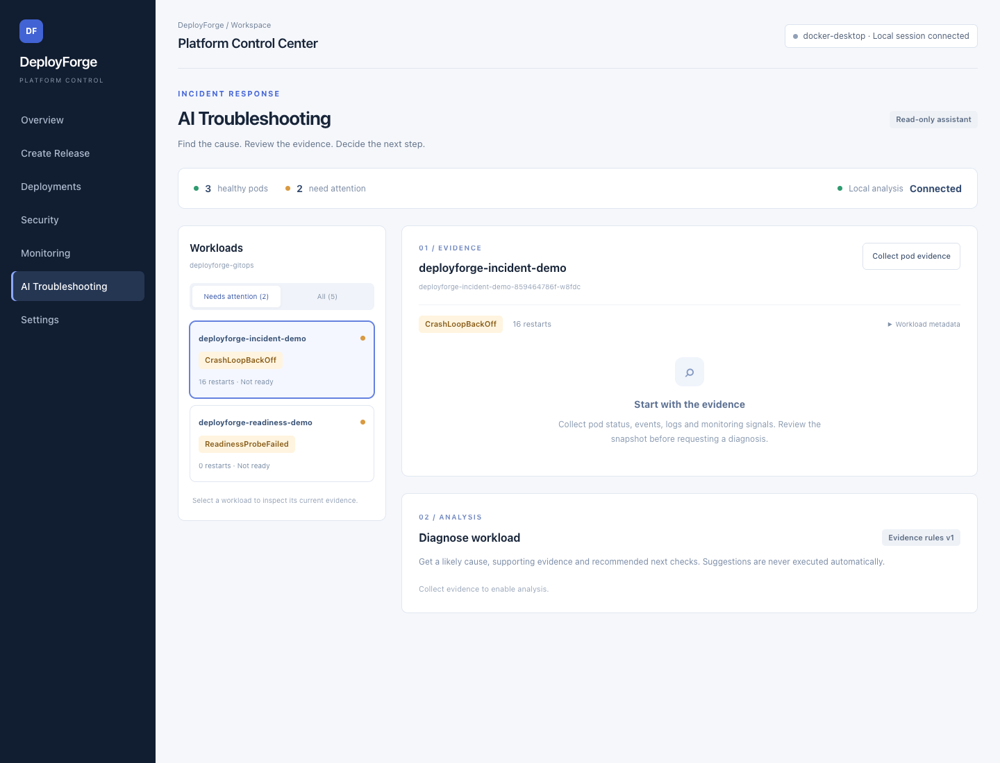

### Workload diagnosis — free local analysis with citations

The free mode interprets the real captured evidence with deterministic rules for startup crashes, readiness failures, image pull failures and healthy status. It identifies its source as **Local analysis** and does not represent an LLM response. The screenshot below is an actual local result, not a mocked OpenAI answer.

Optional **OpenAI** mode uses the Responses API with structured output and explicit approval to send the reviewed snapshot. It requires available API credits. Successful live OpenAI diagnosis has **not** been verified; quota failure handling has been tested. Neither mode can execute commands or remediate automatically.

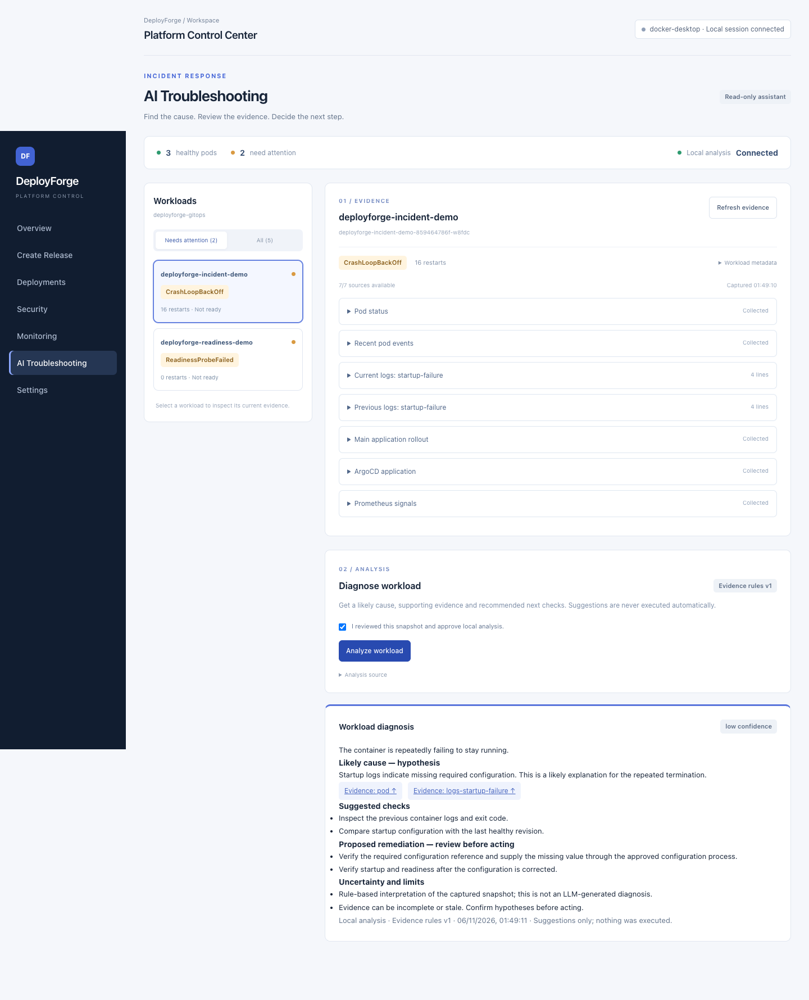

### Settings — browser authorization and execution configuration

Credentials stay on the backend. The browser uses a terminal-approved, short-lived local session. Execution is disabled by default in code and must be enabled explicitly by the operator; a healthy cluster alone does not enable it.


## Workflow walkthrough

The following **automated test screenshots use mocked integrations**. Each image carries a visible test marker. They demonstrate transitions and safeguards without claiming a new live operation. [Assertions, receipts and reproduction commands](docs/testing/README.md).

### Create Tag & Deploy

Choose the source and tag:

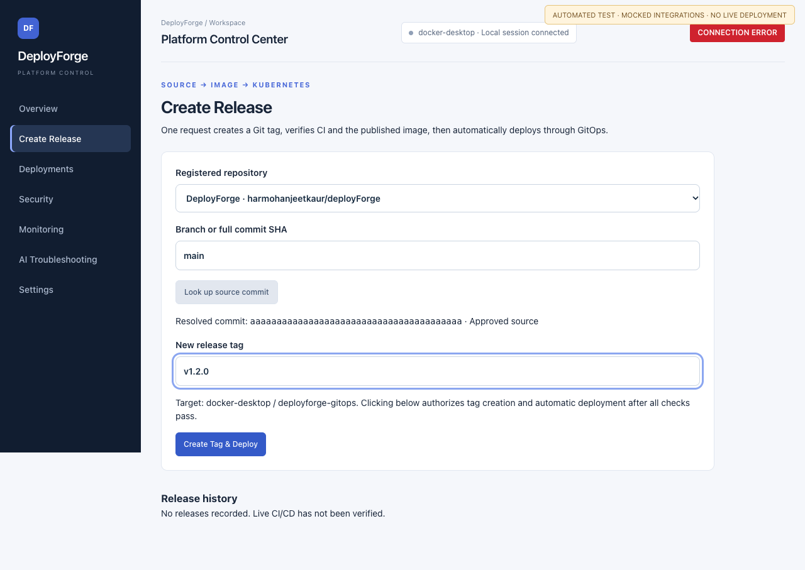

Follow CI and security checks:

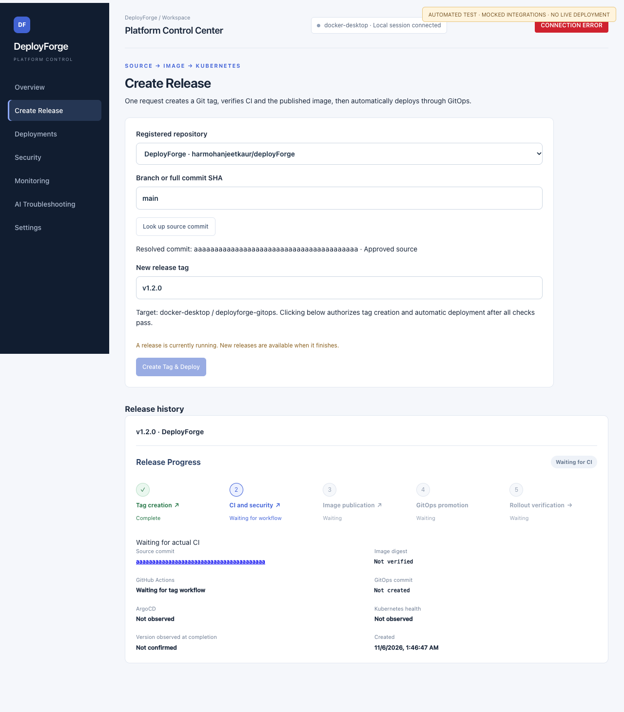

Inspect completion evidence:

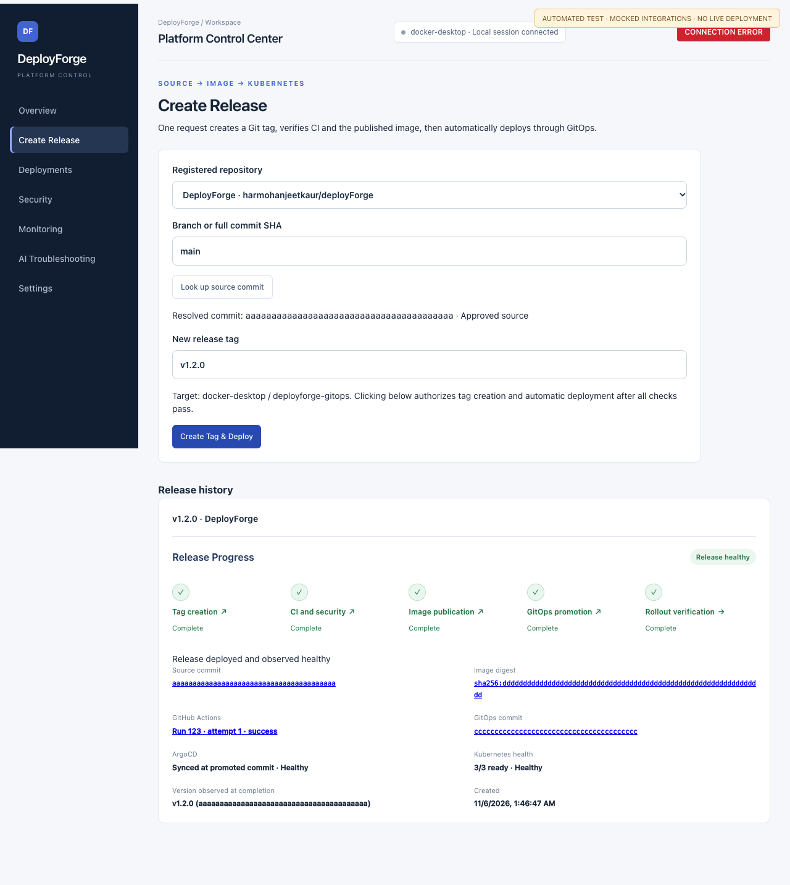

### Deploy an existing image

Review current and target images:

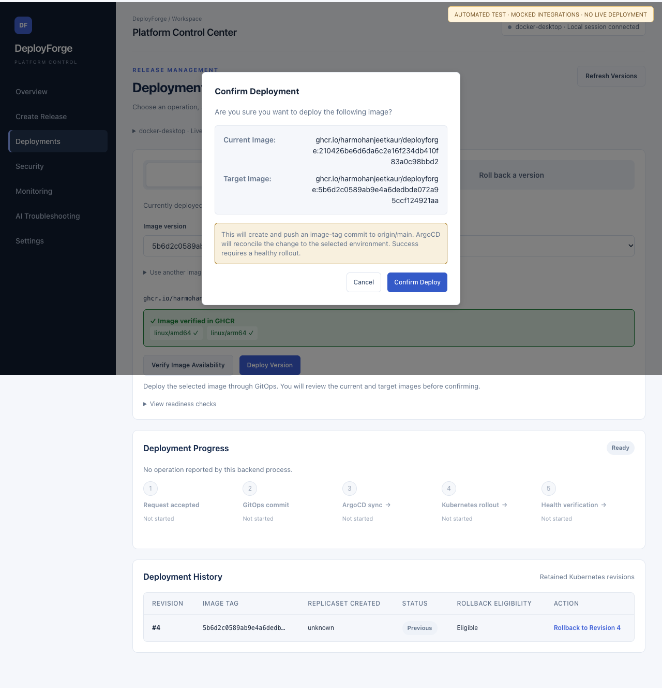

Follow GitOps, ArgoCD and Kubernetes stages:


Confirm observed health:

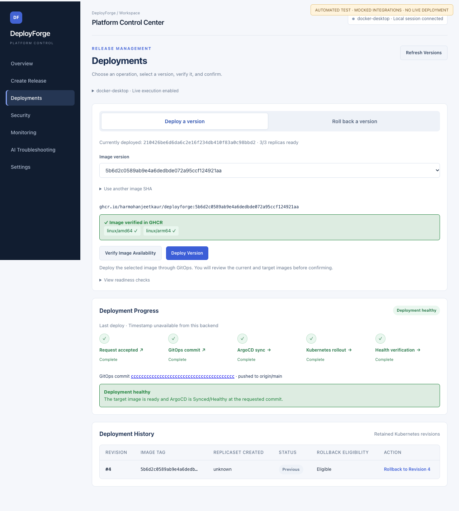

### Roll back a retained revision

Review the rollback target:

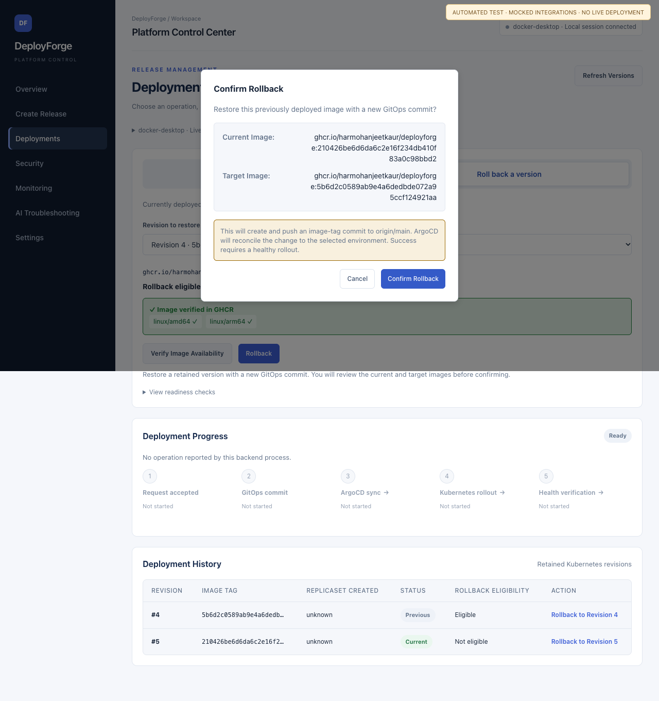

Follow synchronization and rollout:

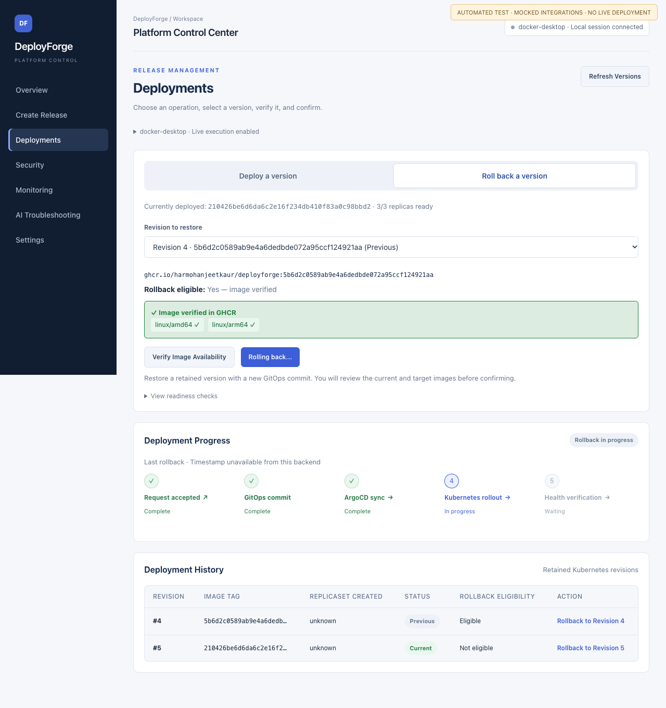

Confirm the restored version is healthy:

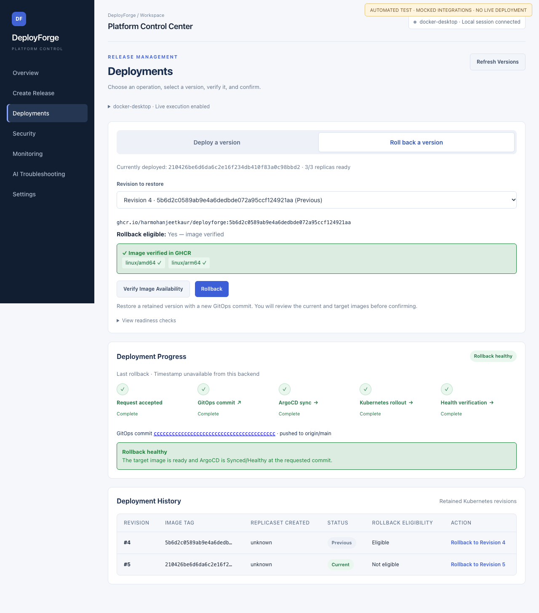

## Engineering decisions

| Decision | Why it matters |
| --- | --- |
| One owner of Helm promotion | Avoids competing CI/dashboard writes to desired state |
| Immutable source SHA images and digest verification | Connects source, build artifacts and selected deployment |
| Durable journal and idempotency | Survives backend restart without recreating tags or blindly repeating uncertain writes |
| Serialized active operations | Prevents overlapping release/deployment/rollback changes; terminal failures do not permanently block new releases |
| Preserved Git state on failure | Allows inspection and read-only reconciliation rather than destructive recovery |
| Approved repositories and server-side secrets | Prevents arbitrary repository deployment and keeps credentials out of browser storage |
| Native architecture builds and caches | Preserves AMD64/ARM64 checks while reducing emulation overhead |
| Evidence-bound diagnosis | Separates observed state from hypotheses and never executes suggested fixes |

## Verification and testing evidence

An existing recorded local release, **v1.1.1**, completed tag creation, CI, publication, GitOps promotion and healthy rollout. Its [Actions run](https://github.com/harmohanjeetkaur/deployForge/actions/runs/42081770680) and saved release history provide the associated evidence. This documents the Docker Desktop path; it is not a claim of production or Azure verification. No new release was run for these screenshots.

**Latest local validation: 180 backend tests passed; 90 browser tests passed, 4 opt-in tests skipped; dashboard lint and build passed.** Raw receipts are in [Testing evidence](docs/testing/README.md). Backend tests cover release failures, duplicate requests/tags, restart recovery, image validation, rollback safeguards, security provenance, log redaction and both diagnostic providers. Browser tests cover UI state transitions, authorization, confirmations, responsive layouts and error states. External mutations are mocked; opt-in live tests remain separate.

The existing GitHub workflow checks the Go application and container artifacts. The local dashboard test results below are separate evidence; they are not described as GitHub CI checks.

## Run locally

Use Node.js 24+ and npm. Google Chrome is used for browser tests. From the repository root:

```sh
npm ci --prefix dashboard
npm ci --prefix dashboard/server

# Terminal 1: free local diagnosis; release/deployment execution stays disabled.
DEPLOYFORGE_AI_PROVIDER=local \
DEPLOYFORGE_ENABLE_RELEASE=false \
DEPLOYFORGE_ENABLE_DEPLOY=false \
npm start --prefix dashboard/server

# Terminal 2: open http://localhost:5173.
npm run dev --prefix dashboard
```

The API binds to `127.0.0.1:3001`. This starts the UI/API without infrastructure installation. Kubernetes views need an accessible cluster; monitoring needs its existing collectors/port-forwards. UI development and mocked tests work with Docker/Kubernetes stopped.

Evidence collection and local diagnosis still require operator authentication. If the private token is already provisioned, load it into the backend environment before starting:

```sh
export DEPLOYFORGE_DEPLOY_TOKEN="$(cat "$HOME/.deployforge-secrets/deploy-token")"
```

Never print or commit this credential. Use owner-only permissions (directory `0700`, file `0600`). In Settings, obtain the browser code and approve it from another trusted terminal:

```sh
npm run authorize --prefix dashboard/server -- <browser-connection-code>
```

The code is not a credential. Backend restart invalidates browser sessions, so reconnect afterward. Stop Vite, the backend or individual port-forwards with **Ctrl+C** in their owning terminal; avoid restarting during active operations.

Live releases additionally require a server-side GitHub token, repository-scoped permissions, Git push credentials, a clean synchronized working tree, cluster/ArgoCD reads and both explicit execution flags. Do not enable these just to browse the UI. Follow the [operator guide](dashboard/README.md) and [release setup](dashboard/docs/self-service-releases.md).

For OpenAI mode, unset `DEPLOYFORGE_AI_PROVIDER`, load `OPENAI_API_KEY` privately and set `DEPLOYFORGE_ENABLE_AI=true`; `DEPLOYFORGE_AI_MODEL` defaults to `gpt-5-mini`. OpenAI errors never silently fall back to local results. [Diagnosis setup and boundaries](dashboard/docs/ai-troubleshooting.md).

### Reproduce local checks

```sh
npm test --prefix dashboard/server
npm run lint --prefix dashboard
npm run build --prefix dashboard
npm run test:e2e --prefix dashboard
cd app && go test ./...
```

## Scope and limitations

The first fully implemented promotion adapter targets the registered DeployForge application. Additional repositories require explicit configuration and an appropriate adapter; arbitrary repositories cannot deploy. Authentication is designed for a trusted local operator, not a hosted multi-user service.

Release history/checkpoints are durable; standalone manual-operation status and incident snapshots/history are process-local. A rollback depends on retained Kubernetes revisions and does not undo database migrations or external state. The sample Go task API stores data in memory.

Optional fault-injection manifests create isolated startup/readiness failures with resource caps; they are not spontaneous production incidents. Missing monitoring or security evidence is shown explicitly. Free local diagnosis is deterministic, not AI inference. A successful real OpenAI response and Azure deployment remain unverified.

## Code map and deeper documentation

| Path | Responsibility |
| --- | --- |
| [`dashboard/src/`](dashboard/src/) | React pages, sessions, progress links and evidence views |
| [`dashboard/server/`](dashboard/server/) | Express APIs, release coordinator, GitOps engine and diagnosis providers |
| [`.github/workflows/ci.yaml`](.github/workflows/ci.yaml) | Go checks, native builds, blocking Trivy scans and release publication |
| [`app/`](app/) | Sample Go task API, probes, metrics and Docker build |
| [`helm/deployforge/`](helm/deployforge/) | Application desired state |
| [`helm/monitoring/`](helm/monitoring/) | Prometheus, Grafana, alerts and exporters |
| [`k8s/demo/`](k8s/demo/) | Isolated fault-injection workloads |
| [`terraform/`](terraform/) | Azure infrastructure definitions |
| [`docs/testing/`](docs/testing/) | Test receipts and labelled workflow captures |

[Dashboard/operator guide](dashboard/README.md) · [Release architecture](dashboard/docs/self-service-releases.md) · [Incident troubleshooting](dashboard/docs/ai-troubleshooting.md) · [Application observability](dashboard/docs/application-observability.md) · [Go API](app/README.md)
