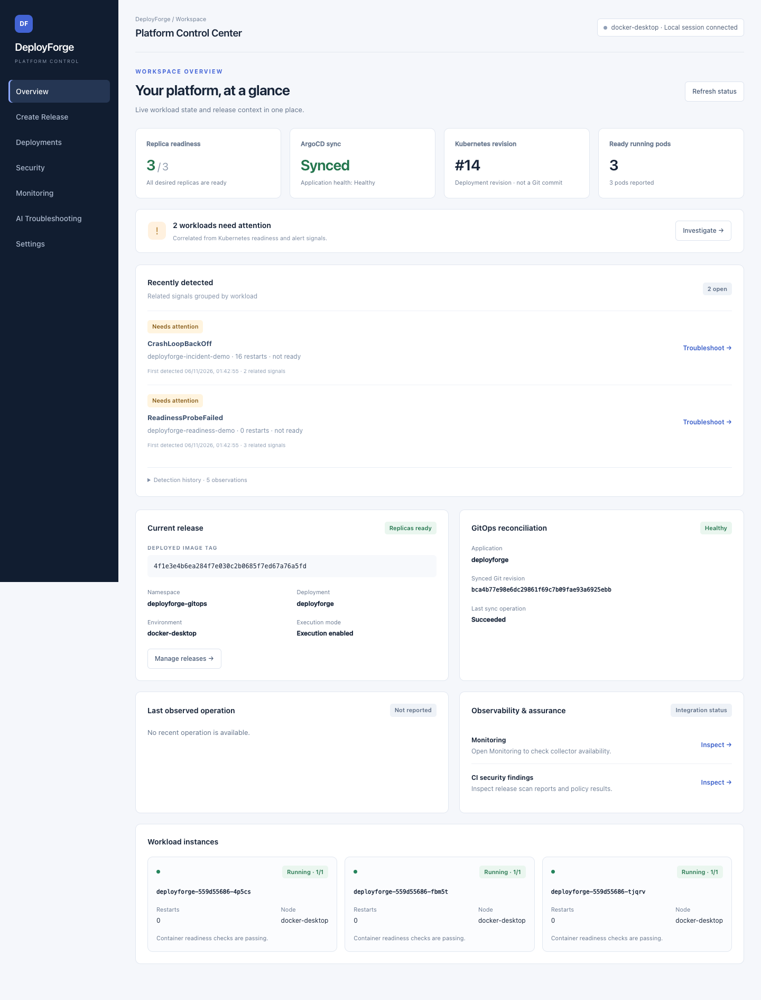
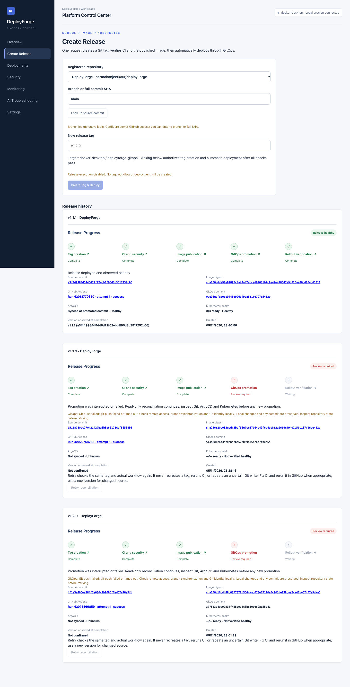
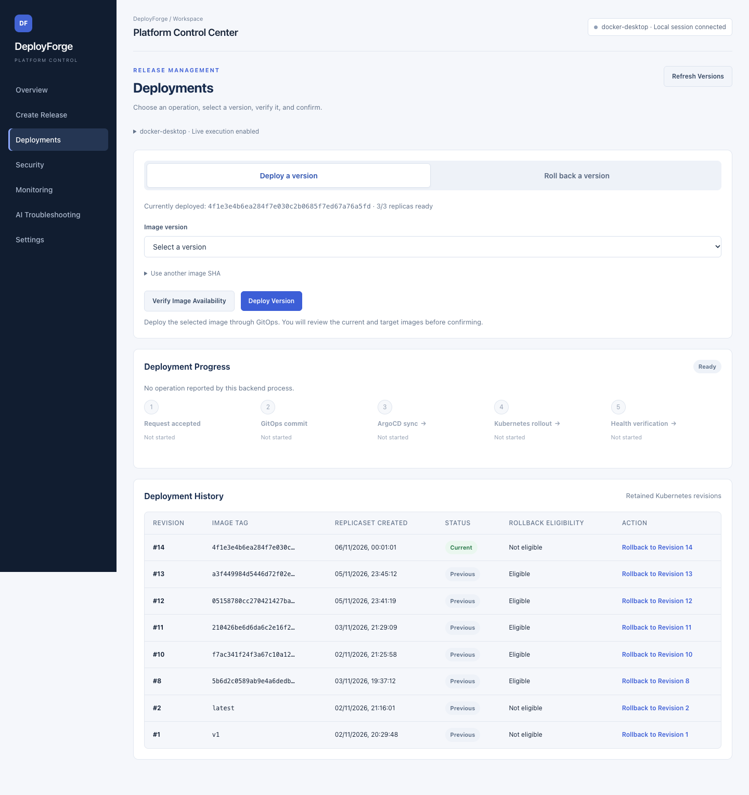
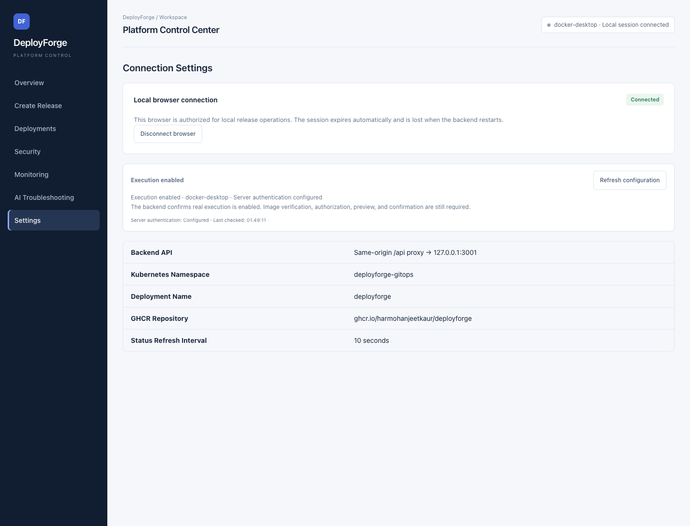

# DeployForge

**From a Git commit to a verified Kubernetes release, through one dashboard.**

DeployForge is a platform engineering portfolio project that lets a developer
select a source commit, create a release, follow its build and security checks,
and see whether the new version actually became healthy in Kubernetes. It also
supports deploying existing images, rolling back retained revisions, inspecting
security reports, and monitoring the application.

**Built with:** React · Express · Go · GitHub Actions · Docker / GHCR · Helm ·
ArgoCD · Kubernetes · Trivy · Prometheus / Grafana

[UI pages](#dashboard-screenshots) · [Workflow walkthrough](#workflow-walkthrough) · [How releases work](#how-a-release-works) ·
[Testing evidence](docs/testing/README.md) · [Run locally](#run-locally) ·
[Architecture and setup](dashboard/docs/self-service-releases.md)

## The problem it solves

A successful container build does not establish that an application was deployed
successfully. A release crosses several systems: source control, CI, a container
registry, deployment configuration, and the running cluster. It can fail between
any two of them.

DeployForge connects those steps and their evidence in one place. A developer
chooses **what to release**; CI produces and scans the image; DeployForge promotes
that verified image through Git; ArgoCD applies the desired state; and the dashboard
checks the rollout. The result is traceable back to the source commit, CI run,
image digest, and deployment commit.

## How a release works

1. Push application code to the registered GitHub repository.
2. In **Create Release**, select a branch or commit and enter a new version tag.
3. Click **Create Tag & Deploy** once. DeployForge resolves the commit and creates
   its Git tag; GitHub Actions tests the application, builds AMD64/ARM64 images,
   and runs blocking Trivy security scans.
4. After successful checks, CI publishes to GitHub Container Registry (GHCR).
   DeployForge verifies the exact run, release evidence, supported platforms,
   and image digest before automatically updating the Helm image version in Git.
5. ArgoCD reconciles that Git change into Kubernetes. DeployForge reports success
   only after the target workload is ready and ArgoCD is synchronized and healthy
   at the promoted commit.

```mermaid
flowchart LR
    Developer[Source commit] --> Dashboard[DeployForge: tag release]
    Dashboard --> CI[GitHub Actions: test / build / scan]
    CI --> Registry[GHCR: published image]
    Registry --> Coordinator[DeployForge: verify and promote]
    Coordinator --> Git[Git: Helm desired state]
    Git --> Argo[ArgoCD: reconcile]
    Argo --> Cluster[Kubernetes: rollout]
    Cluster --> Health[DeployForge: verify health]
```



**CI produces artifacts; DeployForge owns promotion; ArgoCD applies desired state.**
A normal push to `main` does not independently deploy. GitOps means the desired
application version lives in Git, so deployment and rollback changes are reviewable
commits rather than direct edits to the cluster.

## Dashboard screenshots

The UI follows the same release lifecycle. **Overview** is the landing page; the
other pages answer the questions that arise while releasing and operating an app.



| Page | What a reviewer can see |
| --- | --- |
| **Overview** | Is the workload ready? What does ArgoCD report? Which pods need attention? |
| **Create Release** | Which commit is being released, and how far has its tag → CI → image → deployment workflow progressed? |
| **Deployments** | Which published image can be deployed, which revision can be restored, and did the operation complete? |
| **Security** | What did Trivy actually report for each architecture, and did the HIGH/CRITICAL policy pass? |
| **Monitoring** | Are probes passing, replicas available, scrape targets healthy, and alerts active? |
| **Settings** | Is execution enabled on the backend, and is this browser authorized to request changes? |

### Create Release — one request, complete progress and release history

Tag creation, CI/security, image publication, GitOps promotion, and rollout
verification each have a separate state. Evidence links open the relevant source
pages. Failed releases remain visible and do not permanently block a new version.




### Deployments — existing images, confirmation, progress and rollback history

Version labels resolve to immutable source SHA images. Deployment and rollback
require image verification and a confirmation showing current and target images.
Rollback selects a previously retained Kubernetes revision and creates a new
GitOps commit; it does not directly patch Kubernetes.




### Security — policy summary, architecture reports and scan provenance

Reports are downloaded from the exact CI run attempt and validated before display.
Missing evidence stays unknown. A passing HIGH/CRITICAL policy is not a claim that
all possible vulnerabilities are absent.


### Monitoring — application signals, scrape health and active alerts

The page reads Prometheus data, including availability probes and probe latency,
and links to Grafana. Probe latency is distinct from application request latency.
Unavailable collectors or missing series are shown explicitly.


### Settings — execution configuration and local browser authorization

Credentials remain on the server. The browser uses a short-lived local session;
execution is disabled by default and requires operator configuration.




These screenshots use existing local API data. Browser authorization is stubbed
as pending for read-only capture; no real session is approved and its synthetic
connection code is omitted. They document a point in time, not continuous health.

## Workflow walkthrough

The following screenshots are directly visible here, in the order a reviewer
would follow each operation. **These are automated browser-test captures with
mocked integrations**, visibly marked on every image. The live UI captures above
show existing local API data; these test captures demonstrate transitions and
confirmation safeguards without triggering infrastructure changes.

### Create Tag & Deploy

**1. Choose the source and release tag.** The developer selects a registered
repository and commit/branch, then enters a version.


**2. Follow CI and security progress.** Tag creation, CI, image publication,
GitOps promotion and rollout verification appear as distinct stages.


**3. Inspect the completed release.** The result includes the source SHA, CI run,
image digest, deployment commit, ArgoCD state and observed readiness.


### Deploy an existing image

**1. Review the change before confirming.** Current and target images are shown;
cancelling this review does not submit an operation.


**2. Watch deployment stages.** Progress distinguishes GitOps commit creation,
ArgoCD synchronization, Kubernetes rollout and health verification.


**3. Confirm observed health.** A successful result requires the final health
checks rather than merely accepting the request or creating a Git commit.


### Roll back a retained revision

**1. Verify and confirm the rollback target.** The review identifies the current
image and the eligible previously deployed image to restore.


**2. Track the rollback rollout.** Restoring a revision creates a new GitOps
change and follows the same synchronization and health stages.


**3. Verify rollback completion.** The UI reports healthy completion after the
restored target meets the operation’s checks.


See the [test receipts and reproduction commands](docs/testing/README.md) for the
assertions, source and logs behind these images. A real in-progress deployment
or rollback capture is not implied by these mocked test screenshots.

## Engineering decisions

| Decision | Reason |
| --- | --- |
| One owner for Helm promotion | Prevents CI and the dashboard from competing to update deployment state. |
| Immutable SHA images and digest checks | Ties the selected source to the published artifact before promotion. |
| Durable release state and idempotent requests | Preserves progress across Express restarts and avoids recreating tags or blindly repeating uncertain Git writes. |
| Explicit confirmation and operation locks | Prevents duplicate submissions and overlapping deployment/rollback operations. |
| Server-side credentials and registered repositories | Keeps tokens out of browser storage and restricts which applications may use the promotion adapter. |
| Separate build and scan per architecture | Preserves AMD64/ARM64 support; native runners and build caches reduce emulation overhead without removing scans. |

Failures are reported at their stage. A timeout is not success, and an uncertain
Git push is preserved for inspection. Recovery observes existing state rather
than automatically repeating a write or rolling back.

## Verification and testing evidence

A recorded live local release, **v1.1.1**, completed tag creation, CI, publication,
GitOps promotion and healthy rollout. Its history is visible in the Create Release
capture; its [GitHub Actions run](https://github.com/harmohanjeetkaur/deployForge/actions/runs/42081770680)
provides the associated build/scan evidence. This verifies the local Docker Desktop
path, not a production or cloud deployment.

All **nine labelled workflow screenshots** are displayed above. The
[testing evidence guide](docs/testing/README.md) adds actual test logs, test-source
links and reproduction commands for release, deployment and rollback flows.

| Recorded local check — 6 November 2026 | Result |
| --- | --- |
| Complete backend suite | **148 passed** |
| Release, deployment and rollback browser suites | **33 passed** |
| Dashboard lint | **Passed** |

The automated workflow screenshots use **mocked external integrations** and carry
a visible marker. They verify UI behavior and safeguards without changing a real
cluster. The test logs and assertions explain what each capture proves; they are
separate from the recorded live release above.

## Run locally

Use Node.js 24+, npm, and Google Chrome for browser tests. From the repository root:

```sh
npm ci --prefix dashboard
npm ci --prefix dashboard/server

# Terminal 1: start the backend with execution disabled.
env -u DEPLOYFORGE_ENABLE_RELEASE -u DEPLOYFORGE_ENABLE_DEPLOY \
  npm start --prefix dashboard/server

# Terminal 2: open http://localhost:5173 after Vite starts.
npm run dev --prefix dashboard
```

The API binds to `127.0.0.1:3001`. UI development and mocked tests can run with
Docker/Kubernetes stopped. Live workload and monitoring views need their running
integrations. Real releases additionally need approved GitHub API access, Git push
credentials, cluster access, and explicit backend execution configuration.

- [Dashboard/operator guide](dashboard/README.md): sessions, execution flags, stage links, monitoring port-forwards and recovery.
- [Release architecture](dashboard/docs/self-service-releases.md): API contract, permissions, evidence validation and restart behavior.
- [Application observability](dashboard/docs/application-observability.md): instrumentation and collection setup.
- [Sample Go API](app/README.md): endpoints, local execution and Go tests.
- [Reproduce the evidence](docs/testing/README.md#reproduce): test and screenshot commands.

## Scope and next steps

The implemented promotion adapter supports the registered **DeployForge**
application. Repository configuration is structured for extension, but arbitrary
repositories cannot deploy into the cluster. The current authentication model is
for a trusted local operator, not a hosted multi-user service.

Release history and release-owned promotion checkpoints are durable. Standalone
manual-operation status is process-local. Rollback depends on retained Kubernetes
revisions and cannot undo database migrations or external state. The sample Go
workload deliberately stores tasks in memory.

Azure Terraform definitions are included; cloud deployment is not claimed as
verified. AI-powered Kubernetes incident troubleshooting remains planned.

## Code map

| Path | Responsibility |
| --- | --- |
| [`dashboard/src/`](dashboard/src/) | React screens, evidence links, configuration and session handling |
| [`dashboard/server/`](dashboard/server/) | Express API, release coordinator, image verification and GitOps engine |
| [`.github/workflows/ci.yaml`](.github/workflows/ci.yaml) | Go checks, native image builds, blocking scans and GHCR publication |
| [`helm/deployforge/`](helm/deployforge/) | Application desired state and immutable image selection |
| [`helm/monitoring/`](helm/monitoring/) | Prometheus, Grafana, alerts and collector workloads |
| [`app/`](app/) | Go task API, probes, metrics and container build |
| [`terraform/`](terraform/) | Azure infrastructure definitions |
| [`docs/testing/`](docs/testing/) | Test receipts and labelled workflow evidence |
