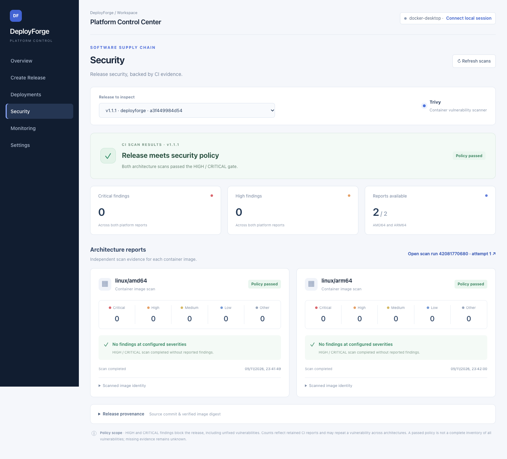
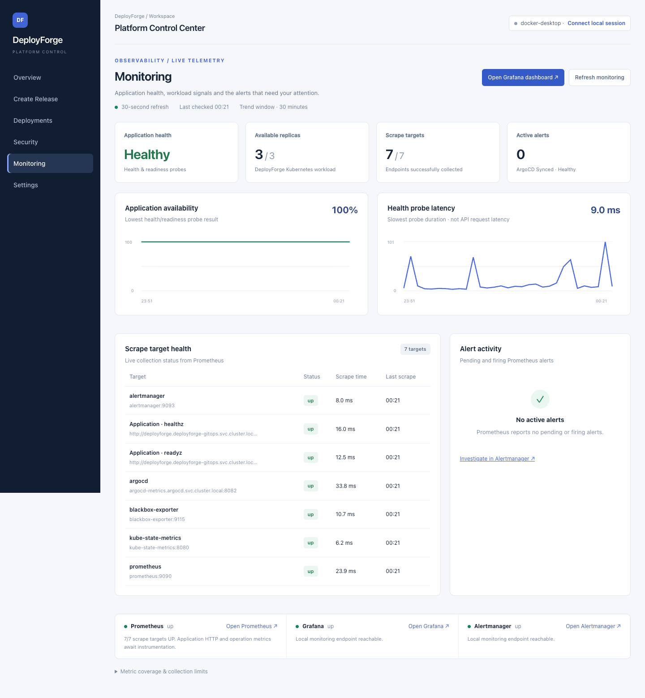

# DeployForge

DeployForge is a local platform engineering control center for releasing a Go
application through GitHub Actions, GHCR, Helm, ArgoCD, and Kubernetes. It combines
one-click releases, verified image promotion, retained-revision rollback, CI
security evidence, and live monitoring in a React dashboard with an Express API.

## What it does

| Page | Capabilities |
| --- | --- |
| Overview | Workload readiness, running pods, ArgoCD synchronization and health |
| Create Release | Select a registered repository and source, create a version tag, track CI and image publication, then automatically promote and verify rollout |
| Deployments | Discover published release versions, verify immutable SHA images, deploy or roll back a retained Kubernetes revision |
| Security | Inspect actual AMD64/ARM64 Trivy reports, HIGH/CRITICAL policy results, findings, fixes, scan times, and CI provenance |
| Monitoring | Application health probes, replica availability, scrape targets, alerts, trends, and Grafana access |
| Settings | Local browser authorization and backend execution configuration |

Progress stages link to the exact GitHub tag, Actions run, pushed GitOps commit,
and relevant live health views. Direct ArgoCD links are optional and configurable.

## Release architecture

```mermaid
flowchart LR
    Source[Developer pushes source] --> UI[DeployForge: Create Tag & Deploy]
    UI --> Tag[Git tag on selected commit]
    Tag --> CI[Go tests and vet]
    CI --> Images[Native AMD64 / ARM64 builds]
    Images --> Scan[Blocking Trivy scans]
    Scan --> GHCR[GHCR images + immutable SHA / version index]
    GHCR --> Verify[DeployForge validates run, evidence and digest]
    Verify --> Helm[Commit and push Helm image.tag]
    Helm --> Argo[ArgoCD synchronization]
    Argo --> K8s[Kubernetes rollout and health verification]
```



CI builds and scans artifacts; **DeployForge owns Helm promotion**. A normal push
to `main` does not independently deploy. Docker builds use architecture-specific
caches; native runners avoid QEMU emulation. Both blocking scans remain mandatory.

A live release has completed this flow in the local Docker Desktop environment.
This is a local portfolio setup; cloud Terraform definitions are included but are
not evidence of a verified cloud deployment. AI incident troubleshooting is planned.

## Dashboard preview

### Security evidence



The summary reflects retained CI reports. A passing HIGH/CRITICAL gate does not
mean every possible vulnerability was scanned or that lower-severity findings are
absent. Missing evidence remains unknown.

### Live monitoring



These screenshots capture local state at one point in time; the UI reads live
sources rather than serving the screenshots or sample data.

## Run the dashboard safely

Use Node.js 24+ and npm. From the repository root:

```sh
npm ci --prefix dashboard
npm ci --prefix dashboard/server

# Terminal 1: explicitly keep release and deployment execution disabled.
env -u DEPLOYFORGE_ENABLE_RELEASE -u DEPLOYFORGE_ENABLE_DEPLOY \
  npm start --prefix dashboard/server

# Terminal 2
npm run dev --prefix dashboard
```

Open **http://localhost:5173**. The backend listens on **127.0.0.1:3001**.
Docker and Kubernetes are not required for frontend development or mocked tests;
live workload and monitoring views require their running integrations.

For real releases, follow the [operator and dashboard guide](dashboard/README.md)
and [authentication, permissions, workflow contract, and recovery guide](dashboard/docs/self-service-releases.md).
GitHub API authentication and Git push authentication must both be configured.
Credentials stay server-side; never put them in React or commit them to Git.
Execution is disabled by default and requires explicit operator configuration.

## Monitoring access and recovery

The monitoring workloads run in `deployforge-monitoring`. The local backend reads
Prometheus through a loopback port-forward. Run each needed connection in its own
terminal, after Docker Desktop and the Kubernetes cluster are available:

```sh
kubectl --context docker-desktop -n deployforge-monitoring port-forward --address 127.0.0.1 svc/prometheus 9090:9090
kubectl --context docker-desktop -n deployforge-monitoring port-forward --address 127.0.0.1 svc/grafana 3000:3000
kubectl --context docker-desktop -n deployforge-monitoring port-forward --address 127.0.0.1 svc/alertmanager 9093:9093
```

Prometheus: **http://127.0.0.1:9090** · Grafana: **http://127.0.0.1:3000** ·
Alertmanager: **http://127.0.0.1:9093**. Stop an individual connection with **Ctrl+C**;
this does not stop its Kubernetes service. Missing local access does not establish
that the in-cluster workload is down. See [application observability](dashboard/docs/application-observability.md).

On an 8 GB Mac, keep only needed applications and port-forwards open, check memory
pressure before starting Docker, and avoid overlapping expensive local builds with
a live demo. These access commands do not install infrastructure or start Docker.

## Validation

```sh
npm test --prefix dashboard/server
npm run lint --prefix dashboard
npm run build --prefix dashboard
npm run test:e2e --prefix dashboard
(cd app && go test ./... && go vet ./...)
helm lint helm/deployforge
```

Browser tests use installed Google Chrome. Default fixtures mock external actions;
optional live checks require explicit environment switches. Security tests cover
artifact provenance, checksum validation, missing reports, policy failures, and
sanitized API errors. Local test results do not establish that a new CI run passed.

## Repository map

- `app/`: Go REST API, health/readiness endpoints, Prometheus instrumentation, Dockerfile.
- `dashboard/`: React UI, Express API, durable release journal implementation and tests.
- `.github/workflows/ci.yaml`: tests, native builds, scans, GHCR publication and evidence.
- `helm/deployforge/`: application desired state; `helm/monitoring/`: monitoring stack.
- `terraform/`: Azure infrastructure definitions.
- `scripts/`: observability validation and local monitoring helpers.

## Go application

A simple Go-based REST API for task management using Go's standard library.

### Features

- **GET /** - Returns application name and status
- **GET /tasks** - Lists all tasks
- **POST /tasks** - Creates a new task with a title
- **GET /healthz** - Health check endpoint
- **GET /readyz** - Readiness check endpoint

### Implementation Details

- Built with Go 1.26.10+ using standard `net/http` package
- Uses Go 1.22+ ServeMux routing
- In-memory task storage using `sync.RWMutex` for thread-safe access
- Tasks are reset when the application restarts
- Graceful shutdown on SIGINT/SIGTERM signals
- Configurable port via PORT environment variable (default: 8080)

### Running the Application

```bash
cd app
go run cmd/api/main.go
```

The server will start on port 8080 by default. To use a different port:

```bash
PORT=8081 go run cmd/api/main.go
```

### API Endpoints

#### Get Application Status
```bash
curl http://localhost:8080/
```

#### List Tasks
```bash
curl http://localhost:8080/tasks
```

#### Create a Task
```bash
curl -X POST http://localhost:8080/tasks \
  -H "Content-Type: application/json" \
  -d '{"title": "My first task"}'
```

#### Health Check
```bash
curl http://localhost:8080/healthz
```

#### Readiness Check
```bash
curl http://localhost:8080/readyz
```

### Running Tests

```bash
cd app
go test ./...
```

### Formatting and Linting

```bash
cd app
gofmt -l .
go vet ./...
```
