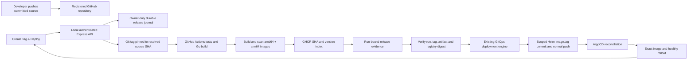

# Self-service releases

Implemented locally with mocked GitHub, registry, Git and cluster integrations.
No live tag, Actions run, image publication, deployment or rollback was performed.
Docker and Kubernetes are not needed for the offline tests below.

## Product flow and ownership



A single Create Tag & Deploy submission authorizes the whole sequence. There is
no second deployment confirmation for this release operation. The pre-existing
manual deployment/rollback screens retain their confirmations and safeguards.

Source is resolved on submission, so a branch moving after a preview does not
change the recorded source SHA. The tag is a lightweight Git tag pinned to that
SHA. A DeployForge release record is created; no GitHub Releases API entity is
needed. Actions run because the tag is pushed via GitHub's create-reference API.

Normal pushes to main and pull requests test, build and scan but do not publish
release images or write Helm. Only version tags publish. CI has no Git contents
write permission and no deployment credentials. DeployForge is the only Helm
promotion writer in this implementation.

## Files and boundaries

- `server/repositories.js`: operator-reviewed application registration. The first
  enabled application is `harmohanjeetkaur/deployForge`, with its fixed GHCR image,
  workflow and docker-desktop target. The API lists this configuration; it cannot
  register arbitrary repositories or accept browser-supplied image/cluster paths.
- `server/github.js`: fixed-host, bounded GitHub REST client. It reads branch/commit,
  tag, run, jobs and evidence; its only GitHub mutation is creating a tag ref.
- `server/release-store.js`: versioned JSON journal, exclusive backend lock,
  queued atomic replacement and file/directory fsync. No database server needed.
- `server/releases.js`: release state machine, scheduling, history, idempotency,
  retry reconciliation and HTTP authorization.
- `server/deployment.js`: existing GitOps engine, with optional durable checkpoints
  and expected-image-digest validation. Rollback eligibility is unchanged.
- `src/CreateRelease.jsx`: registered app/source/version form, progress and history.
- `.github/workflows/ci.yaml`: tests, platform builds, blocking scans, publication,
  run-bound digest evidence. No Helm write job remains.

The registry is designed to contain multiple application records, but only the
DeployForge promotion adapter is implemented. Adding another app requires code
review of its workflow fingerprint, image registry, promotion adapter and target.
Do not simply add a record pointing at the existing adapter for an unrelated app.
The current worker serializes all releases against the single local GitOps target.

## Endpoints

All responses are uncached. Reads expose configuration/status, never credentials.

| Method | Endpoint | Purpose |
| --- | --- | --- |
| GET | `/api/repositories` | Approved registrations and effective release enablement |
| GET | `/api/repositories/:id/sources` | First 100 branches; other branches can be entered directly |
| GET | `/api/repositories/:id/source?ref=…` | Resolve branch/full SHA and verify workflow fingerprint |
| POST | `/api/releases` | Accept one durable tag/build/deploy operation |
| GET | `/api/releases` | Durable release history, newest first |
| GET | `/api/releases/:id` | Exact release and its observed evidence/progress |
| POST | `/api/releases/:id/retry` | Resume observation/reconciliation of the same release |

Creation accepts `repository`, `ref`, `tag`, `requestId`, `execution: "real"` and
`environment`. Stable request IDs make an accepted request safe to repeat if its
response was lost. Reusing an ID with different inputs is rejected. Tag names
must follow `vMAJOR.MINOR.PATCH`, optionally with a prerelease suffix. Build metadata
(`+suffix`) is excluded for container-tag compatibility.

Write endpoints require the exact localhost dashboard Origin and either the
existing approved browser session + CSRF header, or the private operator bearer
credential. Authentication is independent of execution capability. Tag creation
cannot bypass deployment disablement: both release and deployment execution must
be explicitly enabled before the coordinator will perform any mutation.

The implementation starts neither Docker nor Kubernetes. It never shells out to
GitHub CLI, interpolates source refs into shell commands, or forwards GitHub tokens
to signed artifact storage. Upstream response bodies/errors are not returned or
persisted. Read endpoints still require server-side GitHub configuration for
GitHub lookups; loopback binding and same-origin browser access remain the local
operator security boundary.

## Artifact verification and security policy

Before acceptance, preflight checks the configured adapter/target, clean synchronized
tracked main and Kubernetes read access. Existing working changes are never stashed,
reset, committed or discarded automatically. Preflight cannot guarantee the tree
will remain clean during CI; the existing engine rechecks it before promotion.

The selected commit must contain exactly the local reviewed `ci.yaml` bytes. Its
SHA-256 fingerprint is computed when the backend starts and compared against the
GitHub contents response at the selected source SHA. Historical commits without
this workflow, or branches with altered scans, are rejected. After reviewing a
workflow update, restart the backend and select a commit containing that update.

Both Linux architectures are built separately and the exact locally loaded images
are scanned with Trivy. HIGH or CRITICAL vulnerabilities, including unfixed ones,
fail the scan. Scan configuration and ignore files are fixed to `/dev/null` by the
workflow; repository ignore files do not waive policy. Scanner errors also fail.
Platform images are pushed only after that platform passes. The multi-platform
version/SHA index is created only after both platform jobs succeed. A failing
release may leave one scanned platform candidate in GHCR, but cannot promote.

A final `release.json` artifact contains repository, version tag, source SHA,
image name/index digest, run ID/attempt, platforms and passed security policy.
Backend verification binds all these fields to the approved repository and exact
tag-triggered workflow. Main builds, unrelated tags/SHAs and foreign repositories
cannot satisfy this match. Multiple matching run IDs require operator review.
Artifacts are selected by exact run ID/attempt and their archive digest is checked
before bounded in-memory ZIP parsing. Only `release.json` is read; paths are never
extracted. Evidence retention is 90 days, subject to repository retention limits.

The coordinator hashes the actual GHCR SHA-index response, checks its digest
header, verifies amd64/arm64 and matches the digest to CI evidence. It rechecks the
Git tag and workflow attempt immediately before requesting promotion. The engine
rechecks the expected digest as part of its own image verification.

CI refuses to overwrite an existing SHA or version index. Use a new source commit
for a new live release. This includes old SHA images published by the previous
main-push workflow. Candidate platform tags contain run ID, attempt and architecture.
Protect `v*` Git tags against force updates/deletion and restrict package writes.
Helm still deploys SHA tags to preserve rollback compatibility; it is not digest
pinned, so publisher immutability remains a trust assumption. Do not retag SHA images.

## Durability, concurrency and restart recovery

The default state location is `.deployforge-state/`, ignored by Git. Alternatively
set `DEPLOYFORGE_STATE_DIR` to a stable absolute directory on a local disk. It must
be owned by the backend account with mode 0700; journal files are 0600. Back up
this directory if history must survive loss of the machine. Do not run it on NFS.

One backend process owns a lock. A dead owner's PID can be recovered; live,
invalid or ambiguous locks fail closed. Recovery itself is serialized. If a
process dies while holding the `lock-recovery` directory, an operator must inspect
processes and state before removing that stale recovery directory. Do not remove
locks from a running backend. Journal write failures stop further execution.

Release state is persisted before tag creation and before invoking promotion.
The GitOps engine checkpoints before Helm writes, commit and push, and after the
commit/push/observations. Active releases exclude manual deployment and rollback;
an already active manual operation rejects new releases. GitHub workflow concurrency
serializes builds/publication without cancelling the running workflow. External
manually created tags are not automatically promoted by DeployForge.

On restart (with execution still explicitly enabled):

- Before/after tag creation: read the exact remote ref. If already present at the
  pinned SHA, observe it without another create-ref call. A changed tag is rejected.
- During CI/image verification: resume the same record, exact run and evidence.
- After promotion intent: NEVER invoke a fresh deployment automatically. If a
  saved GitOps commit is still remote main and ArgoCD/Kubernetes converge exactly
  to it, read-only reconciliation can complete the release. Otherwise retain
  `needs-review`, preserve the exclusion and inspect Git/cluster state.

Git writes and a journal cannot be committed atomically. If the process dies after
Git accepted a commit/push but before that checkpoint was saved, automatic retry
could duplicate or overwrite work. The deliberate `needs-review` state handles
that uncertainty. Retry is observation-only for an attempted Git write. There is
no automatic re-push, rollback, tag deletion or destructive cleanup. An operator
must resolve ambiguous Git state and reconcile the journal before allowing a new
promotion; there is no browser action to bypass this safeguard.

CI/security/image failures before promotion are terminal and retained in history.
A known engine validation failure before any write is also retryable after fixing
prerequisites; it repeats all evidence checks before a fresh promotion request.
Uncertain or attempted writes remain excluded from that retry path.
Retry observes the same tag's actual workflow again (including a newer GitHub
rerun attempt); it does not dispatch or rerun Actions. For changed source, create
a new version. For a failed existing run, fix the underlying issue and use GitHub's
rerun control when appropriate, then retry reconciliation. Polling outages remain
explicitly unavailable and never imply deployment success.

The UI reports the version and health observed at release completion. Historical
success does not claim the version is still current after a later deployment or
rollback; use Overview/Kubernetes for current live state.

## GitHub credentials and later live setup

No credentials were loaded and no execution flags were enabled for implementation.
Safe local startup from repository root:

```sh
env -u DEPLOYFORGE_GITHUB_TOKEN -u DEPLOYFORGE_DEPLOY_TOKEN \
  DEPLOYFORGE_ENABLE_RELEASE=false DEPLOYFORGE_ENABLE_DEPLOY=false \
  npm start --prefix dashboard/server
npm run dev --prefix dashboard
```

For a separately approved live run, provision `DEPLOYFORGE_GITHUB_TOKEN` securely
in the backend environment. A fine-grained PAT restricted to this repository is
supported. A GitHub App installation token can also be injected, but minting and
refreshing App tokens is an operator responsibility; this implementation does not
store App private keys or implement OAuth/token refresh. Expiry pauses API access;
restore server authentication and restart to resume persisted progress.

Minimum GitHub repository permissions:

| Credential | Permissions |
| --- | --- |
| Backend PAT/App token | Contents write (tag refs and source reads), Actions read (runs/jobs/artifacts); Metadata read is implicit |
| Backend token, when required for workflow-bearing references | Workflows write, per GitHub create-reference permission policy |
| Actions `GITHUB_TOKEN` | Contents read, Packages write only in image jobs |
| Existing local GitOps push identity | Permission to push the scoped Helm commit to main under repository policy |

The backend does not need Actions write, package publish access or admin scope.
GHCR verification currently supports public anonymous pull, as the existing
engine does. Private package pull authentication is not implemented. The workflow's
`GITHUB_TOKEN` publishes GHCR packages associated with its repository; configure
package permissions if the package already exists under another publisher.

Use a PAT/App token for tag creation, not an Actions `GITHUB_TOKEN`: GitHub suppresses
most workflow triggers generated by the latter. Documentation:
[Git references](https://docs.github.com/en/rest/git/refs#create-a-reference),
[workflow runs](https://docs.github.com/en/rest/actions/workflow-runs),
[artifacts](https://docs.github.com/en/rest/actions/artifacts), and
[workflow triggering](https://docs.github.com/en/actions/how-tos/write-workflows/choose-when-workflows-run/trigger-a-workflow).

Before the first live release, separately approve and complete:

1. Review/preserve the existing pending work, then commit and push the reviewed
   workflow/application/dashboard changes. No commit or push is performed by this
   implementation session. Selected source must include the reviewed workflow.
2. Enable Actions, package publishing and the required tag/branch policies. Review
   vulnerability findings; do not weaken policy to force a demonstration to pass.
3. Restore Docker/Kubernetes and verify application, ArgoCD and resource health.
   Confirm ArgoCD watches main and `helm/deployforge` in this same repository.
4. Establish a clean tracked main synchronized with remote, Git push credentials,
   Git identity, durable state directory and one backend process.
5. Securely provision GitHub/local operator credentials and explicitly enable BOTH
   `DEPLOYFORGE_ENABLE_RELEASE=true` and `DEPLOYFORGE_ENABLE_DEPLOY=true`, with
   `DEPLOYFORGE_KUBE_CONTEXT=docker-desktop`. Browser pairing must be repeated after
   backend restart. These steps authorize automatic deployment after CI.
6. Select a new committed source SHA without an existing SHA image and unused
   version tag. Approve a real end-to-end exercise and inspect all evidence.

## Offline validation

```sh
npm test --prefix dashboard/server
npm run lint --prefix dashboard
npm run build --prefix dashboard
npm run test:e2e --prefix dashboard
(cd app && go test ./...)
helm lint helm/deployforge
helm lint helm/monitoring
```

Do not enable any `DEPLOYFORGE_LIVE_*` or `DEPLOYFORGE_READ_ONLY_*` opt-in browser
checks during offline verification. Backend tests inject mock credentials and
integrations; no production execution flags or credentials are changed. Browser
release tests intercept every API route and simulate observed outcomes.

The workflow YAML and embedded Bash syntax can be checked locally, but Docker
builds, Trivy database access, GHCR publication, real GitHub tag-trigger matching,
artifact storage redirects and ArgoCD rollout must still be verified in the first
approved live run. Passing mocked tests is not end-to-end CI/CD verification.

## Implementation verification — November 5, 2026

- Backend: 139 tests passed, including original deployment/rollback regressions,
  release success/failure, duplicate tags, invalid input, concurrency, API failures,
  digest/evidence validation, journal persistence, restart recovery and authorization.
- Browser regression suite: 71 passed, four opt-in live checks skipped. Four focused
  release tests cover one-click progress, disabled mode, security failure/retry,
  session authorization, history after navigation and mobile overflow.
- Go API/metrics tests passed. Frontend lint and production build passed.
- Both Helm charts linted. Workflow YAML and all embedded Bash blocks parsed.
  `actionlint` is not installed; no Actions execution/build/scan was attempted.
- Updated live local API GET checks returned healthy, both release/deployment
  execution disabled, authentication unconfigured and empty release history.

Some HTTP/browser tests initially could not bind ports in the sandbox; they passed
when rerun with localhost access. These permission failures were environmental.
All final executed checks passed. Existing uncommitted work was preserved.
