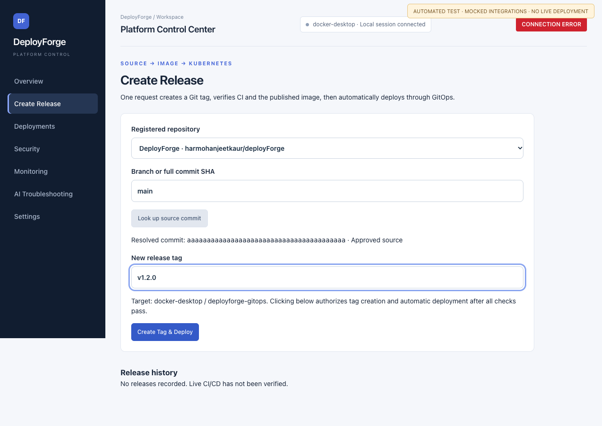
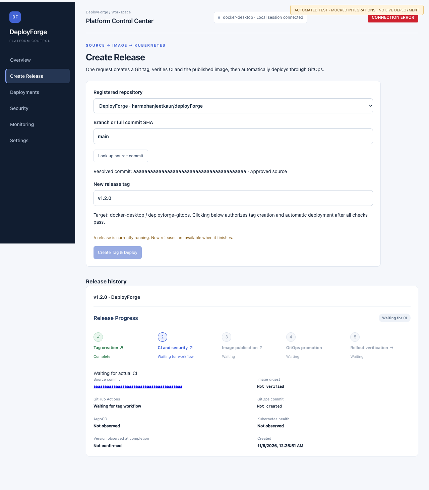
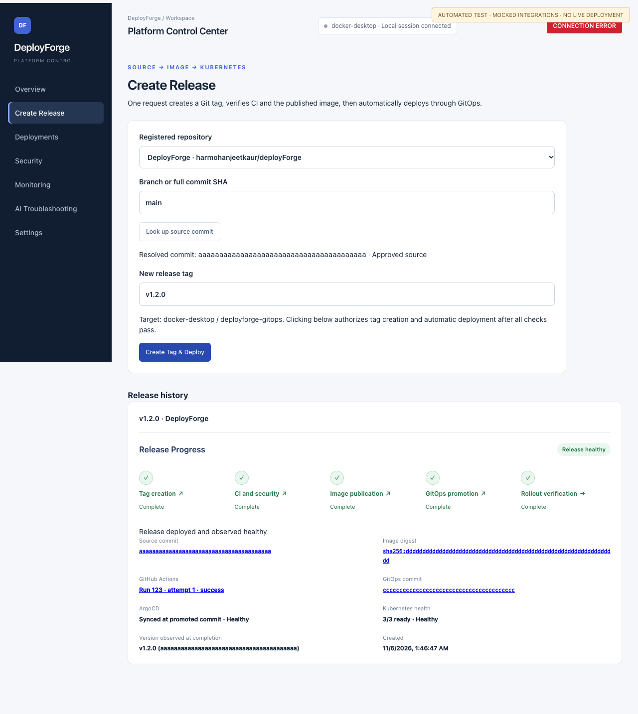
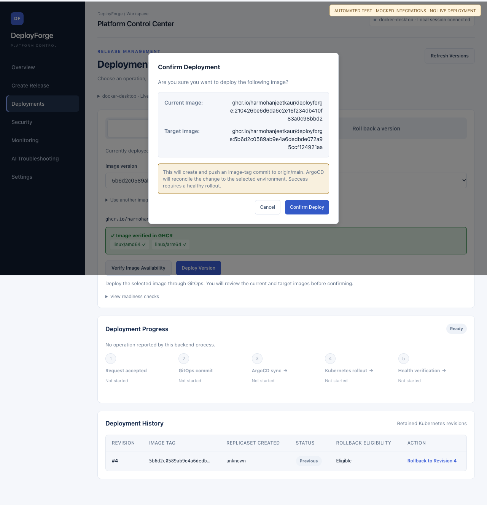
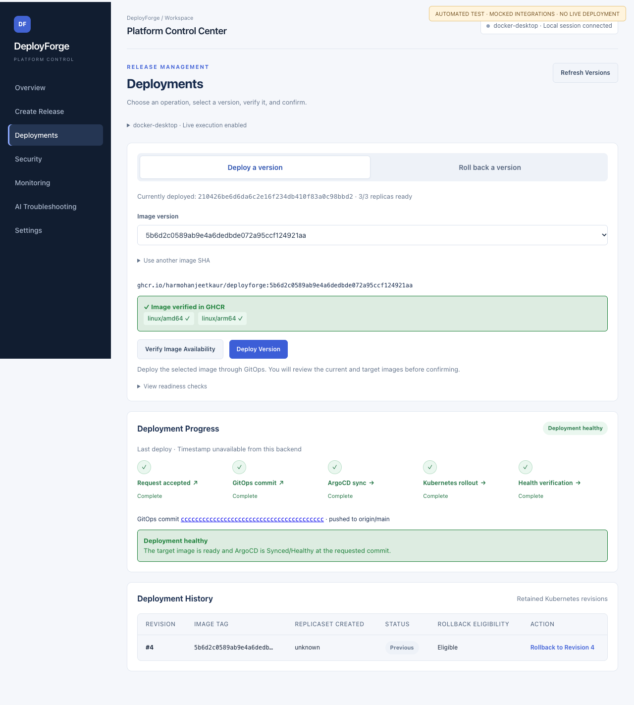
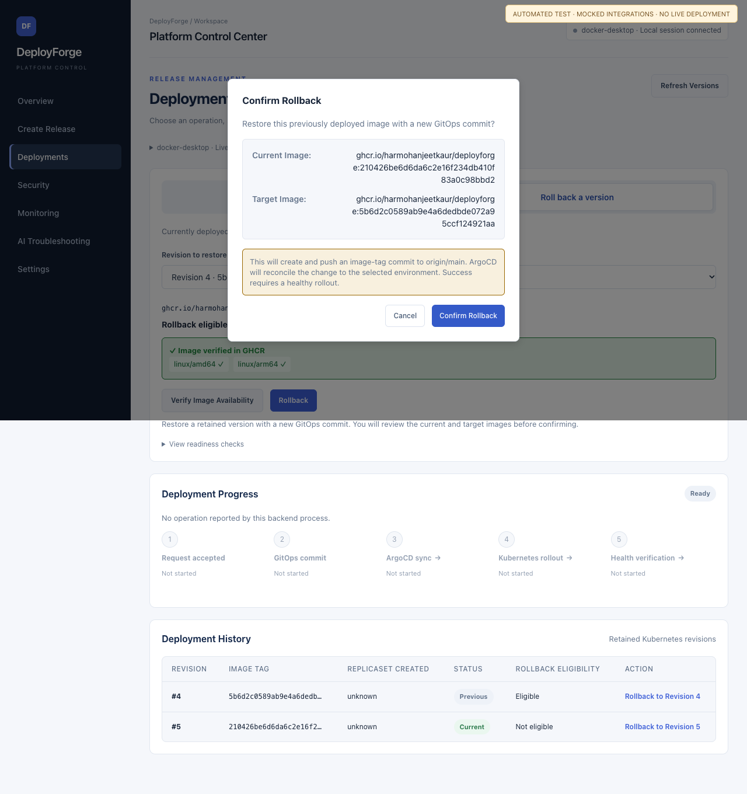
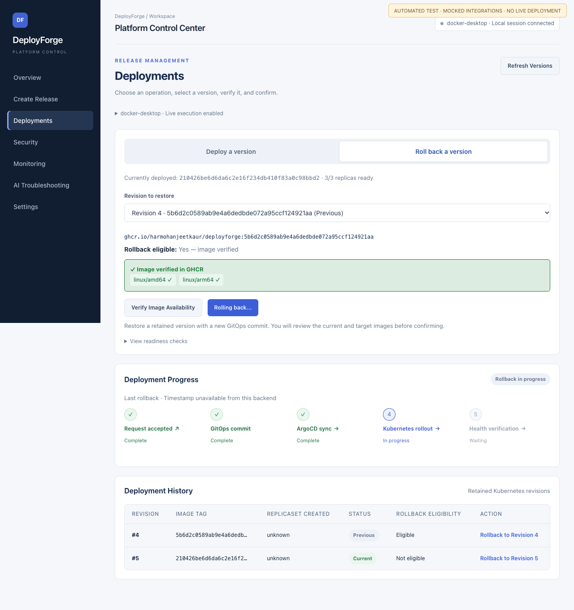
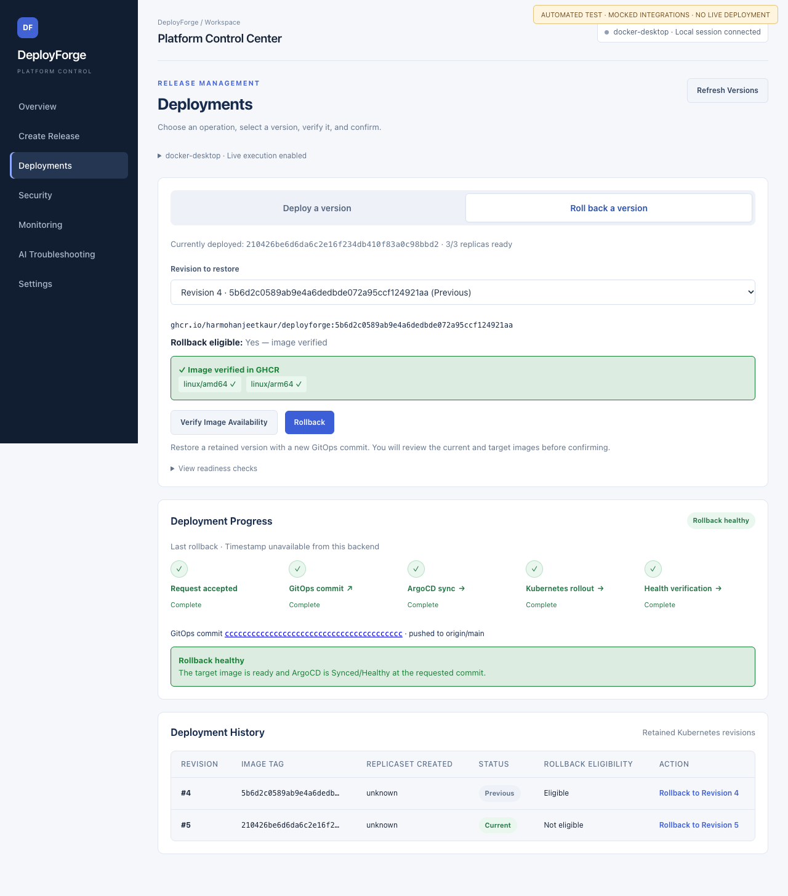

# Testing evidence

Captured on **6 November 2026 (Asia/Kolkata)** against baseline commit `3846a3d`
plus the documentation-capture helper and test screenshot checkpoints in this
working tree. These results describe this local run, not a GitHub Actions result.

## Results and receipts

| Check | Result | Evidence |
| --- | --- | --- |
| Complete Express/backend test suite | 148 passed, 0 failed | [Actual backend output](backend-results.txt) |
| Release, deployment and rollback browser suites | 33 passed, 0 failed | [Actual browser output](browser-results.txt) |
| Dashboard lint | Passed | `npm run lint --prefix dashboard` |

Backend and browser tests mock external mutations. Browser fixtures intercept API
requests; pressing a confirmation button in these tests reaches a mock, never a
live Git tag, Git push, registry publication, Kubernetes deployment, or rollback.
The tests assert request counts, payloads, authorization, state transitions and
failure behavior. A screenshot alone does not establish those assertions; the
linked test source and logs provide their context.

All workflow images below have a visible **AUTOMATED TEST · MOCKED INTEGRATIONS ·
NO LIVE DEPLOYMENT** marker. Fictional commit IDs, run IDs and timestamps in these
images are test fixtures. The [main README gallery](../../README.md#dashboard-screenshots)
contains separate read-only captures of all six pages using existing live API data.

## Create Tag & Deploy

[Test source](../../dashboard/e2e/releases.spec.js). The successful workflow test
resolves source, submits exactly one release intent, observes CI and publication,
checks digest/run/health evidence, and retains history after navigation. Other
cases cover disabled execution, security failure, unauthorized sessions, and
blocking active work without blocking failed/review-required history.

### Source and version selection




### CI in progress




### Release completes with image and rollout evidence




## Deploy an existing image

[Test source](../../dashboard/e2e/production-ui.spec.js). Tests verify the review
shows both current and target images and cancellation sends no deployment POST.
The progress test tracks commit creation, ArgoCD sync, Kubernetes rollout, and
health verification independently before accepting success. Additional cases
reject simulation responses and missing health proof, recover authorization,
and guard duplicate confirmation.

### Deployment confirmation




### Deployment in progress


### Deployment healthy




## Roll back a retained revision

[Test source](../../dashboard/e2e/rollback.spec.js). Tests select an eligible
retained revision, verify the image, inspect current/target images and confirm
exactly one authenticated rollback request. They also cover requested/in-progress/
succeeded states, timeouts, authentication errors, invalid/current/unretained
revisions, changing selections and cancelling confirmation without submission.

### Rollback confirmation




### Rollback in progress




### Rollback healthy




## Reproduce

From the repository root, with dashboard dependencies and Google Chrome installed:

```sh
npm test --prefix dashboard/server
npm run lint --prefix dashboard
DEPLOYFORGE_DOC_SCREENSHOTS=1 npm run test:e2e --prefix dashboard -- \
  releases.spec.js production-ui.spec.js rollback.spec.js
```

The screenshot switch only adds captures to already mocked tests. Omitting it
runs the same assertions without writing documentation images. Test captures are
written to `docs/images/testing/`. Browser tests reuse the local Vite server when
present or start it on port 5173. They do not require Docker or Kubernetes.

To refresh the **live read-only page gallery**, first have the dashboard and API
running with the relevant read integrations available, then run:

```sh
DEPLOYFORGE_CAPTURE_UI=1 node scripts/capture-ui-docs.mjs
```

This separate helper starts no services, approves no browser session, blocks
non-GET operation requests, and never clicks action confirmations. Session
responses are stubbed as pending so no connection codes appear. All other page
data comes from existing GET APIs. It stops if a required API returns an error.
It writes six screenshots under `docs/images/`; timestamps and current state
will naturally differ between captures.
